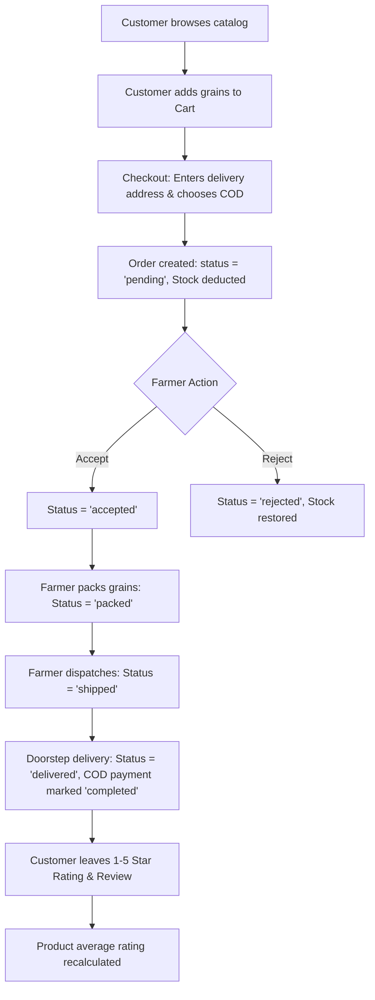

# 🌾 Kisan Direct - Farmer to Consumer Grain Marketplace

A complete full-stack web application designed to eliminate middlemen, mandi brokers, and inflated price layers by connecting Indian grain farmers directly with households and consumers.

---

## 🌾 Problem Statement & Value Proposition

- **The Problem**: Traditional agricultural supply chains force farmers to sell grains to middlemen/mandi brokers at low, unremunerative prices. Brokers then add high commissions, polish/blend grains, and resell to end consumers at inflated supermarket rates.
- **The Solution (Kisan Direct)**: A direct farmer-to-consumer marketplace where farmers list single-origin, unpolished grains at fair prices, receive 100% direct payouts, and consumers enjoy fresh, authentic produce at lower cost.

---

## 🛠️ Technology Stack (100% Pure JavaScript)

- **Backend**: Node.js & Express.js
- **Database**: MongoDB with Mongoose ODM (via `MONGO_URI`)
- **Frontend**: Plain HTML5, CSS3 (Custom Agricultural Green Theme), Vanilla JavaScript (`fetch()` with `credentials: 'include'`)
- **Authentication**: JWT stored in secure `httpOnly` cookies + `bcryptjs` password hashing
- **Access Control**: Role-Based Access Control (RBAC) protecting routes for `farmer`, `customer`, and `admin`

---

## 📁 Project Structure

```text
kisan-direct/
├── server.js                      # Main Express server entry point & static asset server
├── package.json                   # Project dependencies and npm scripts
├── .env                           # Environment configuration
├── .env.example                   # Example environment template
├── config/
│   └── db.js                      # MongoDB connection configuration
├── models/
│   ├── Admin.js                   # Admin schema
│   ├── Farmer.js                  # Farmer schema (name, email, password, phone, location)
│   ├── Customer.js                # Customer schema (name, email, password, phone, address)
│   ├── Product.js                 # Product schema (name, category, pricePerKg, stockKg, image, description, farmer)
│   ├── Cart.js                    # Customer shopping cart schema
│   ├── Order.js                   # Order schema with 5-stage status lifecycle
│   ├── OrderDetails.js            # Line-item order breakdown schema
│   ├── Payment.js                 # Payment transaction records (COD support)
│   └── Feedback.js                # Customer rating (1-5) and review schema
├── middleware/
│   └── auth.js                    # JWT verification and role-based access control
├── controllers/
│   ├── authController.js          # Authentication (Register, Login, Logout, Session, Profile)
│   ├── farmerController.js        # Farmer inventory CRUD, order pipeline & earnings
│   ├── customerController.js      # Cart management
│   ├── productController.js       # Public catalog browsing, search & category filters
│   ├── orderController.js         # Order checkout, live tracking & post-delivery reviews
│   └── adminController.js         # Admin dashboard statistics & data management
├── routes/
│   ├── authRoutes.js              # /api/auth
│   ├── farmerRoutes.js            # /api/farmers (Protected: Farmer)
│   ├── customerRoutes.js          # /api/customers (Protected: Customer)
│   ├── productRoutes.js           # /api/products (Public)
│   ├── orderRoutes.js             # /api/orders (Protected: Customer / Farmer)
│   └── adminRoutes.js             # /api/admin (Protected: Admin)
├── seedAdmin.js                   # One-time script to seed Admin and realistic demo data
└── public/
    ├── index.html                 # Marketplace homepage
    ├── register.html              # Dynamic role-based registration (Farmer/Customer)
    ├── login.html                 # Login page with 1-click demo autofill buttons
    ├── products.html              # Grain catalog with live search & filters
    ├── product-details.html       # Single product view with farmer credentials & reviews
    ├── cart.html                  # Shopping cart management
    ├── checkout.html              # Delivery address & Cash on Delivery checkout
    ├── farmer-dashboard.html      # Farmer portal (Products, Orders, Earnings, Profile)
    ├── customer-dashboard.html    # Customer portal (Orders tracking stepper, Reviews)
    ├── admin-dashboard.html       # Admin portal (Analytics & table deletion controls)
    ├── style.css                  # Custom green/earthy responsive design system
    └── script.js                  # Shared frontend API wrapper, auth state, and toast alerts
```

---

## ⚡ Getting Started

### 1. Prerequisites
- **Node.js** (v16+ recommended)
- **MongoDB** (Local instance on `mongodb://localhost:27017` or MongoDB Atlas URI)

### 2. Install Dependencies
```bash
npm install
```

### 3. Configure Environment Variables
Create or verify `.env` file in the root directory:
```env
PORT=5000
MONGO_URI=mongodb://localhost:27017/kisan-direct
JWT_SECRET=kisan_direct_super_secret_jwt_key_2026_agro_market
NODE_ENV=development
```

### 4. Seed Database (Admin & Sample Marketplace Data)
Run the seed script to create the default Admin and initial demo farmers, grain products, orders, and reviews:
```bash
npm run seed
```

### 5. Start the Server
```bash
npm start
```
Or for development with automatic restart:
```bash
npm run dev
```

Visit the application in your browser: **`http://localhost:5000`**

---

## 🔑 Demo Accounts

| Role | Email | Password | Access / Portal |
| :--- | :--- | :--- | :--- |
| **Admin** | `admin@kisandirect.com` | `AdminPassword123` | [admin-dashboard.html](http://localhost:5000/admin-dashboard.html) |
| **Farmer** | `ramesh.farmer@kisandirect.com` | `Kisan@123` | [farmer-dashboard.html](http://localhost:5000/farmer-dashboard.html) |
| **Customer** | `priya.customer@kisandirect.com` | `Kisan@123` | [customer-dashboard.html](http://localhost:5000/customer-dashboard.html) |

*(Quick 1-Click login buttons are also embedded directly on the `login.html` page for convenience).*

---

## 🔄 Core Order Lifecycle Workflow



---

## 🛡️ Security & Architecture Features

1. **Authentication Security**:
   - Passwords salted and hashed with `bcryptjs`.
   - JWT token transmitted in `httpOnly` secure cookies preventing XSS token theft.
   - Dual-layer protection: backend middleware validation + frontend dashboard route guards.
2. **Stock Consistency**:
   - Stock quantities strictly verified prior to order creation.
   - Stock deducted upon placement and automatically restored if farmer rejects the order.
3. **Traceability**:
   - Each grain listing clearly showcases the farmer's name, farm village/district, and direct contact details.
